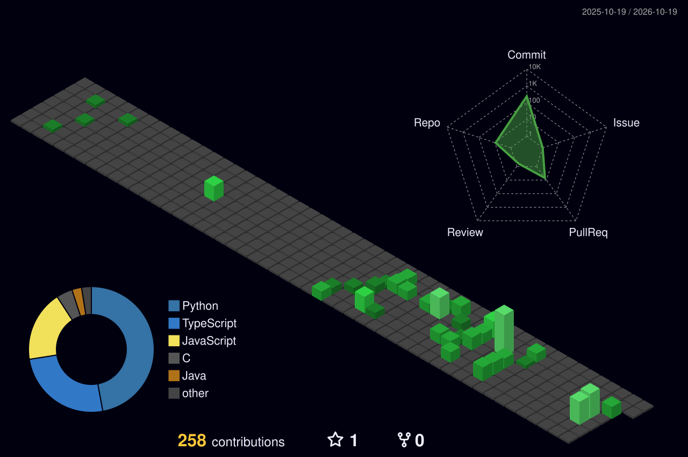

<h1 align="center">Luiz Felipe Naves</h1>

<b>Backend Developer · Java / Spring Boot · Engenharia de Software (UnB)</b>

---

### 👨‍💻 Quem sou
Estudante de Engenharia de Software na UnB (FGA) e estagiário de desenvolvimento no DETRAN-DF,
onde migrei serviços de Java 8 para Java 21 e desenvolvi APIs REST com Spring Boot + Oracle.

### 🎯 Foco atual
- Backend com Java/Spring e segurança de aplicações
- Estruturas de dados e algoritmos (LeetCode em Python)
- Estudando para a AWS Cloud Practitioner

### 🛠️ Stack

  

### 📊 Atividade

### 📫 Contato

